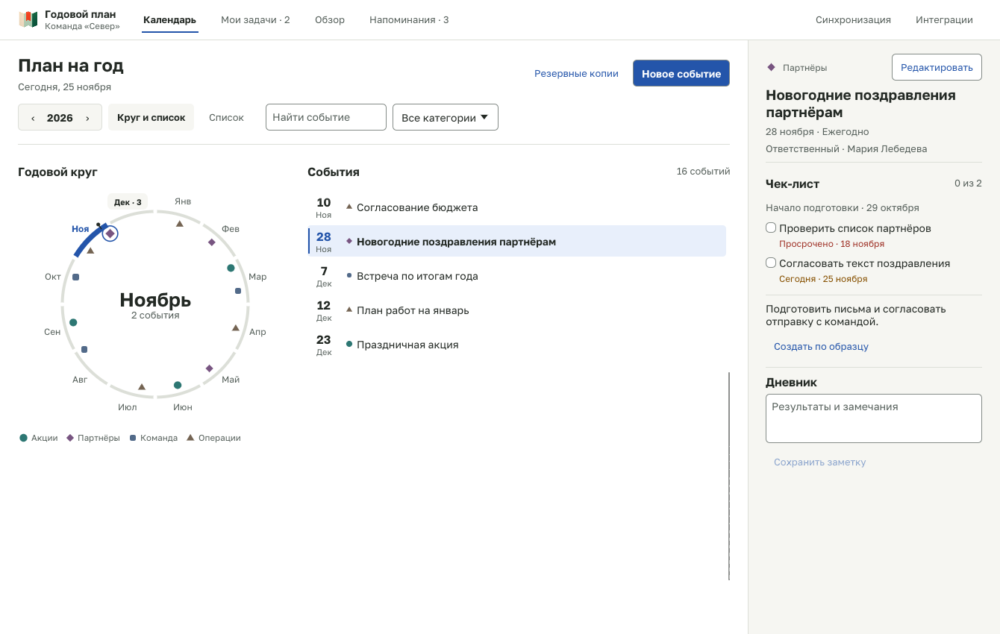

# Годовой план

Календарь для команд, у которых каждый год повторяются акции, встречи, отчёты и поздравления. Годовой круг показывает, что запланировано на ближайшие месяцы. У каждого события есть ответственный, дата начала подготовки и чек-лист со своими сроками.

В офисе вся команда может вести один календарь по локальной сети даже при отключении интернета. Рабочая копия хранится на одном включённом компьютере компании. Из дома или командировки тот же календарь доступен только сотрудникам с отдельным разрешением. Облачная учётная запись не требуется. Если нужен прямой обмен локальными копиями без постоянно включённого компьютера, выберите автономный режим.

[Настроить офисный и удалённый входы](ONLINE.md#один-календарь-для-офиса-и-удалённых-сотрудников) · [Условия обработки персональных данных](DATA-PROTECTION.md)



## Сервер для ИТ-службы

Начиная с версии 0.5.50 администратор открывает локальную панель командой `godovoy-online configure DIR`, выбирает «Россия» или «Беларусь» и нажимает «Сохранить настройки». С этого момента сервер закрывает внешний вход и скрывает описания и дневник. Офис продолжает работать по локальной сети. В панели также можно ограничить сотрудника его назначениями, отозвать все его ключи и скачать отчёт для внутренней проверки. [Как включить профили и что проверяет компания](DATA-PROTECTION.md)

Сервер доступен для Linux, Windows и macOS. При перезагрузке основного сервера офис может продолжить работу на резервном узле с тем же актуальным томом в течение заданного ИТ срока. Клиенты открывают встроенный веб-календарь сервера. [Сервер для скачивания](https://github.com/BIackFIame/godovoy-plan/releases/latest) · [Развёртывание, переключение и возврат](SERVER.md)

Сотрудник может подключить ИИ-помощника к своим назначениям по MCP. ИТ выдаёт персональный ключ в карточке сотрудника. По умолчанию помощник видит только свои события и чек-листы. Отдельно можно разрешить отметки выполнения и записи дневника. [Подключение помощника](MCP.md)

## Скачать и запустить

Откройте опубликованный выпуск и раскройте **Assets**. Выберите файл с нужным окончанием из таблицы. Контрольные суммы приложений находятся в `SHA256SUMS.txt` того же выпуска. [Скачать приложения](https://github.com/BIackFIame/godovoy-plan/releases/latest)

| Устройство | Пакет и установка |
|---|---|
| Windows 10 и новее | Распакуйте архив приложения `Windows-x64.zip`, `Windows-ARM64.zip` или `Windows-x86.zip` и запустите `godovoy-plan.exe`. Для большинства 64-разрядных ПК подходит x64. Для окна нужен драйвер OpenGL 2.0 или новее. |
| macOS, Apple Silicon и Intel | Распакуйте универсальный архив приложения `macOS.zip` и переместите `GodovoyPlan.app` в «Программы». У сборки локальная подпись ad hoc, при первом запуске возможна проверка Gatekeeper. |
| Android 8.0 и новее | Скачайте `Android.apk` на телефон и откройте его для установки. В пакете ARM64, ARMv7 и x86-64. APK подписан тестовым ключом. |
| iPhone и iPad, от iOS 16 | Архив `iOS-Xcode.zip` содержит проект и библиотеки для устройства и симулятора ARM64. ИТ-служба подписывает приложение для установки на устройства. [Установка через Xcode и готовые сборки](mobile/ios/README.md) |

У клиентских пакетов имя начинается с `GodovoyPlan-`, у серверных — с `GodovoyServer-`.

## Первый календарь за несколько шагов

1. На первом компьютере введите своё имя и название команды, затем нажмите **Создать календарь**.
2. Чтобы подключить коллегу, попросите его выбрать **Присоединиться** и прислать **запрос устройства**. В разделе **Синхронизация** создайте по этому запросу код и передайте его коллеге. Код действует 15 минут. Оба приложения должны оставаться открытыми и видеть друг друга в локальной сети.
3. Создайте событие, например «Поздравить партнёров» на 20 декабря. Включите ежегодный повтор, назначьте ответственного и укажите начало подготовки 5 ноября. В чек-листе задайте сроки для списка адресатов, согласования текста и отправки.
4. С начала подготовки событие появится в **Моих задачах** ответственного. Итог можно записать в дневнике. В следующем году список дел повторится с чистыми отметками, а запись за прошлый год сохранится.

Если у сотрудника есть компьютер и телефон, после подключения свяжите их в разделе **Синхронизация → Устройства сотрудников**. Личные задачи будут видны на обоих устройствах. Доступ к каждому можно отозвать отдельно. [Пошаговая инструкция](GUIDE.md#один-сотрудник-на-компьютере-и-телефоне)

## Обмен и доступ

- **В одной сети** устройства синхронизируются напрямую по зашифрованному соединению. Новый локальный календарь работает с закрытыми портами обмена. Когда вы включаете обмен, создаёте приглашение или присоединяетесь к коллеге, клиент использует TCP 45736 для обмена и UDP 45737 для обнаружения устройств. На паузе оба порта освобождаются. Если автопоиск недоступен, введите IPv4-адрес и порт коллеги вручную.
- **Без общей сети** участники одного календаря могут передать зашифрованный файл `.yrplan` через флешку или системный способ передачи файлов. Файл предназначен для уже подключённого устройства с действующим ключом.
- **Если сотрудник уходит**, на управляющем устройстве отзовите доступ для каждого его компьютера и телефона. Выдайте новые приглашения оставшимся участникам. С этого момента вводите рабочие изменения в календарь с новым ключом. Уже полученные данные и сохранённые копии остаются у прежнего владельца. [Порядок отзыва доступа](review/v0.5/DEVICE-ACCESS.md)

## Документация

| Задача | Где посмотреть |
|---|---|
| Настроить календарь, напоминания и локальную сеть | [Руководство для Windows и macOS](GUIDE.md) |
| Подключить телефон | [Мобильное приложение](mobile/README.md) |
| Подключить Bitrix24, Neactor или собственную систему | [API и мост интеграций](API.md) · [Спецификация OpenAPI](openapi.yaml) |
| Сохранить и восстановить данные | [Резервные копии](review/v0.5/BACKUPS.md) · [Восстановление](review/v0.5/RECOVERY.md) |
| Узнать, что проверено в выпуске | [Проверки мобильных клиентов](MOBILE-TESTS.md) · [История изменений](CHANGELOG.md) |

## Собрать из исходников

### Где находится код

| Часть приложения | Точка входа и ответственность |
|---|---|
| Общее ядро Rust | [src/lib.rs](src/lib.rs) объединяет модель событий, планирование, локальное хранилище, файлы обмена и синхронизацию по сети. Мобильная библиотека использует ядро с отключёнными возможностями по умолчанию. |
| Настольный клиент | [src/main.rs](src/main.rs) запускает интерфейс. [src/ui.rs](src/ui.rs) управляет экранами, специализированные компоненты находятся в [src/ui](src/ui). |
| Интеграции на компьютере сотрудника | [src/api.rs](src/api.rs) обслуживает локальный API. Отдельный процесс [godovoy-bridge](src/bin/godovoy-bridge.rs) подключает внешние системы. |
| Офисный сервер и MCP | [godovoy-online](src/bin/godovoy-online.rs) запускается отдельно. [src/online](src/online) содержит обработчики запросов и веб-клиент, [storage/online.rs](src/storage/online.rs) отвечает за серверное хранилище и работу под общей блокировкой. |
| Телефон | [Мобильное ядро](mobile/core/src/lib.rs) предоставляет интерфейс Rust для [Android](mobile/android) и [iOS](mobile/ios). Владение памятью и команды описаны в [протоколе](mobile/PROTOCOL.md). |

### Команды сборки

Для настольной версии нужны Rust 1.94 или новее и системные инструменты сборки. На macOS установите Xcode Command Line Tools. Для Windows с MSVC нужны Build Tools с C++ и Windows SDK.

```sh
cargo build --release --locked
cargo test --locked
```

При добавлении нового интеграционного набора в `tests/` зарегистрируйте его в секции `[[test]]` корневого `Cargo.toml`. Список целей можно проверить командой `cargo metadata --no-deps --format-version 1`.

Готовое приложение и мост интеграций появятся в `target/release`. Мобильные клиенты используют то же ядро Rust. Команды сборки и требования к инструментам находятся в инструкциях для [Android](mobile/android/README.md) и [iOS](mobile/ios/README.md).
