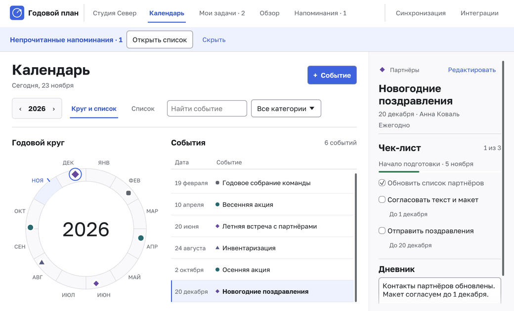

# Годовой план

Календарь для команд, у которых каждый год повторяются акции, встречи, отчёты и поздравления. Годовой круг показывает, что запланировано на ближайшие месяцы. У каждого события есть ответственный, дата начала подготовки и чек-лист со своими сроками.

Компания выбирает, где хранить календарь. В автономном режиме сотрудники работают с локальными копиями и обмениваются изменениями. В режиме **Серверный календарь** рабочая копия хранится на одном компьютере компании. Сотрудникам нужна связь с этим компьютером по офисной сети, VPN или через интернет. Облачная учётная запись не требуется.

[Включить обязательную связь и выдать доступ](ONLINE.md) · [Требования к персональным данным в России и Беларуси](DATA-PROTECTION.md)



## Скачать и запустить

| Устройство | Пакет и установка |
|---|---|
| Windows 10 и новее | Выберите [x64](https://github.com/BIackFIame/godovoy-plan/releases/download/v0.5.43/GodovoyPlan-0.5.43-Windows-x64.zip), [ARM64](https://github.com/BIackFIame/godovoy-plan/releases/download/v0.5.43/GodovoyPlan-0.5.43-Windows-ARM64.zip) или [x86](https://github.com/BIackFIame/godovoy-plan/releases/download/v0.5.43/GodovoyPlan-0.5.43-Windows-x86.zip). Распакуйте архив и запустите `godovoy-plan.exe`. Для большинства ПК с 64-разрядной Windows подходит x64. |
| macOS, Apple Silicon и Intel | Распакуйте [универсальную сборку](https://github.com/BIackFIame/godovoy-plan/releases/download/v0.5.43/GodovoyPlan-0.5.43-macOS.zip) и переместите `GodovoyPlan.app` в «Программы». У сборки локальная подпись ad hoc, при первом запуске возможна проверка Gatekeeper. |
| Android 8.0 и новее | Скачайте [APK](https://github.com/BIackFIame/godovoy-plan/releases/download/v0.5.43/GodovoyPlan-0.5.43-Android.apk) на телефон и откройте его для установки. В пакете ARM64, ARMv7 и x86-64. Эта версия подписана тестовым ключом. |
| iPhone и iPad, от iOS 16 | [Проект Xcode](https://github.com/BIackFIame/godovoy-plan/releases/download/v0.5.43/GodovoyPlan-0.5.43-iOS-Xcode.zip) содержит интерфейс SwiftUI и библиотеки Rust для устройства и симулятора ARM64. Для установки на устройство нужна сборка и подпись вашей команды Apple. Готового IPA в этом выпуске нет. |

Все файлы выпуска и их контрольные суммы доступны в [GitHub Releases](https://github.com/BIackFIame/godovoy-plan/releases/latest).

## Первый календарь за несколько шагов

1. На первом компьютере введите своё имя и название команды, затем нажмите **Создать календарь**.
2. Чтобы подключить коллегу, попросите его выбрать **Присоединиться** и прислать **запрос устройства**. В разделе **Синхронизация** создайте по этому запросу код и передайте его коллеге. Код действует 15 минут. Оба приложения должны оставаться открытыми и видеть друг друга в локальной сети.
3. Создайте событие, например «Поздравить партнёров» на 20 декабря. Включите ежегодный повтор, назначьте ответственного и укажите начало подготовки 5 ноября. В чек-листе задайте сроки для списка адресатов, согласования текста и отправки.
4. С начала подготовки событие появится в **Моих задачах** ответственного. Итог можно записать в дневнике. В следующем году список дел повторится с чистыми отметками, а запись за прошлый год сохранится.

Если у сотрудника есть компьютер и телефон, после подключения свяжите их в разделе **Синхронизация → Устройства сотрудников**. Личные задачи будут видны на обоих устройствах. Доступ к каждому можно отозвать отдельно. [Пошаговая инструкция](GUIDE.md#один-сотрудник-на-компьютере-и-телефоне)

## Обмен и доступ

- **В одной сети** устройства синхронизируются напрямую по зашифрованному соединению. Настольный клиент по умолчанию использует TCP 45736 для обмена и UDP 45737 для обнаружения. Если автопоиск недоступен, введите IPv4-адрес и порт коллеги вручную.
- **Без общей сети** участники одного календаря могут передать зашифрованный файл `.yrplan` через флешку или системный способ передачи файлов. Файл предназначен для уже подключённого устройства с действующим ключом.
- **Если сотрудник уходит**, на управляющем устройстве отзовите доступ для каждого его компьютера и телефона. Выдайте новые приглашения оставшимся участникам. С этого момента вводите рабочие изменения в календарь с новым ключом. Уже полученные данные и сохранённые копии остаются у прежнего владельца. [Порядок отзыва доступа](review/v0.5/DEVICE-ACCESS.md)

## Документация

| Задача | Где посмотреть |
|---|---|
| Настроить календарь, напоминания и локальную сеть | [Руководство для Windows и macOS](GUIDE.md) |
| Подключить телефон | [Мобильное приложение](mobile/README.md) |
| Подключить Bitrix24, Neactor или собственную систему | [API и мост интеграций](API.md) · [Спецификация OpenAPI](openapi.yaml) |
| Сохранить и восстановить данные | [Резервные копии](review/v0.5/BACKUPS.md) · [Восстановление](review/v0.5/RECOVERY.md) |
| Узнать, что проверено в выпуске | [Проверки мобильных клиентов](MOBILE-TESTS.md) · [История изменений](CHANGELOG.md) |

## Собрать из исходников

Для настольной версии нужны Rust 1.94 или новее и системные инструменты сборки. На macOS установите Xcode Command Line Tools. Для Windows с MSVC нужны Build Tools с C++ и Windows SDK.

```sh
cargo build --release --locked
cargo test --locked
```

Готовое приложение и мост интеграций появятся в `target/release`. Мобильные клиенты используют то же ядро Rust. Команды сборки и требования к инструментам находятся в инструкциях для [Android](mobile/android/README.md) и [iOS](mobile/ios/README.md).
